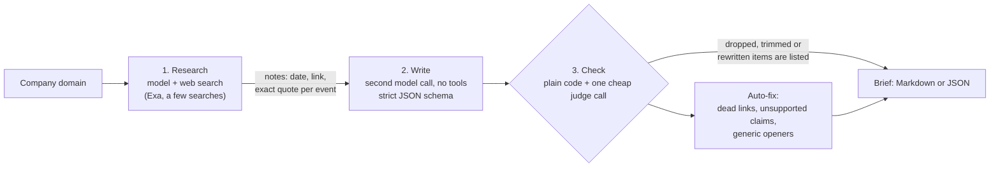

# Account Brief

Reps spend 15 to 30 minutes researching each account, or skip the research and send the generic email. Account Brief takes a company domain and, in about a minute, returns a one-page brief: what they sell, what changed in the last 90 days, three likely pains, and three cold-email openers. Every fact links to its source and shows the sentence behind it.

**Live demo:** [account-brief-three.vercel.app](https://account-brief-three.vercel.app)  ·  **Sample brief:** [examples/notion.so.md](examples/notion.so.md)

## What a rep gets

Same prospect, same rep, two emails.

| Without the brief | With the brief |
|---|---|
| Hi [First name], I hope this finds you well. I wanted to reach out because teams like yours often struggle with pipeline generation and rep productivity. Our platform can help. | Hi [First name], **Notion's October synced Salesforce databases now feed its agents directly.** How are your reps keeping CRM data fresh before outbound sends? |

The highlighted line comes with a source tier (`first-party`, `second-party` or `third-party`), the date, the exact quote from the page, and the link.

## How it works



1. **Research.** One model call with the OpenRouter web-search tool. It returns plain notes, and every event carries a date, a URL and a verbatim quote.
2. **Write.** A second call with no tools turns only those notes into the brief, in a fixed schema (Pydantic validates it; one retry if it breaks a rule such as "under 25 words").
3. **Check.** Code verifies each event: inside the 90-day window, URL actually returned by the search, quote actually present in the search text. One cheap call then judges whether the source text supports each claim.
4. **Auto-fix.** Dead links (404/410) are dropped. Unsupported claims are dropped, partly supported ones are trimmed to what the source says, and any pain or opener built on a removed claim is rewritten from the evidence that is left. Generic openers get one rewrite. Anything removed or changed is listed under "what we could not verify".

## Results

Run on 10 companies: notion.so, linear.app, ramp.com, vercel.com, retool.com, clay.com, attio.com, gong.io, figma.com, airtable.com.

| | v2 baseline | Current |
|---|---|---|
| Briefs | 10 | 10 |
| Facts hand-checked | 34 of 99 (spot-check by me) | not yet hand-checked |
| Wrong facts found | 0 of 34 | not measured |
| Links checked by script | 69, 0 dead, 2 blocked | 35, 0 dead, 1 blocked |
| Quote found on the live page | 62 of 67 readable pages | 31 of 34 readable pages |
| Openers flagged generic (script) | 0 of 30 | 0 of 30 |
| Triggers per brief | 6.9 | 3.5 |
| Cost per brief | $0.046 | $0.045 |
| Seconds per brief | about 65 (estimated from file times) | 74 |

How to read this honestly:

- The hand-check covered a third of the facts in the **baseline** run. It found no errors, which for a sample this size is not proof there are none.
- After the baseline I added a relevance rule, a claim-support check and auto-repair. Those cut the average from 6.9 to 3.5 triggers per brief on purpose: fewer events, each with better backing. The current numbers are script checks only. I have not hand-checked them.
- The script checks prove a link loads and a quote is on the page. They do not prove the summary is right, which is why the support check exists.

Reproduce: `python eval.py check evals/after`, tick the boxes in `review.md`, then `python eval.py tally evals/after`.

## Quickstart

```bash
git clone https://github.com/akshatiwarix/claygent-equivalent && cd claygent-equivalent
python3 -m venv .venv && .venv/bin/pip install -r requirements.txt && cp .env.example .env   # add your OpenRouter key
.venv/bin/python brief.py notion.so --persona "VP Sales" --offer "AI outbound tooling"
```

Output goes to `briefs/notion.so.md` (and `.json`). Python 3.11+.

For a batch, put domains in `accounts.csv` (column: `domain`) and run `python brief.py --csv accounts.csv`. You get one brief per row and `briefs/summary.csv` with `domain, status, top_trigger, tokens, searches, cost_usd, seconds`. A domain that fails is skipped and recorded, and the batch carries on.

To run the website locally: `.venv/bin/pip install -r requirements-dev.txt && .venv/bin/uvicorn app:app --port 8000`.

## Decisions and trade-offs

- **Two calls, not one.** Web search and strict JSON output don't combine reliably on every provider, and one call that does both is hard to debug. Splitting them also puts a place for checks between the model's notes and the brief a rep sees.
- **Capped searches.** Each Exa search costs $0.007 and adds seconds, so the research call asks for at most five. That is a request, not a guarantee: OpenRouter reported 4 to 9 searches per brief in my runs. A hard cap would use the request-level `max_tool_calls` field, which I have not turned on.
- **Verify in code, not in the prompt.** Telling a model "don't make things up" is a hope. A quote check, a date check and a link check are tests. The one model-based check (does the source support the claim) runs on a separate call.
- **Fewer triggers over more.** An event the tool can't back up is dropped or trimmed, and the brief says so.
- **Public demo spending.** One live run per visitor per day, a global daily cap, counters in Redis, and a hard credit limit on the OpenRouter key. If the counters are unreachable, live runs switch off.
- **What a paid enrichment API would add.** Real headcount and funding (the brief often has to say "sources conflict"), named contacts so openers can address a person, job-posting data with reliable dates, and intent or technographic signals.

## How this fits a GTM stack

Briefs are the research step. They feed an enrichment pipeline that adds contact and firmographic data, and, next, a signal engine that watches for the kinds of events a brief is built from, so research starts when something changes instead of when a rep has time.

## Project layout

| File | What it does |
|---|---|
| `brief.py` | Command line: one domain, or `--csv` for a batch |
| `pipeline.py` | The whole flow as one function, with no file writes |
| `llm.py` | OpenRouter calls and usage logging |
| `prompts.py` | All prompts |
| `models.py` | Pydantic models for the brief |
| `checks.py`, `repair.py` | Verification and auto-fix |
| `render.py` | Brief to Markdown |
| `app.py`, `limits.py` | Web API and spend protection |
| `public/` | The website |
| `eval.py`, `evals/` | Eval harness and the saved runs |
| `data/examples/` | Saved briefs the site serves for free |
